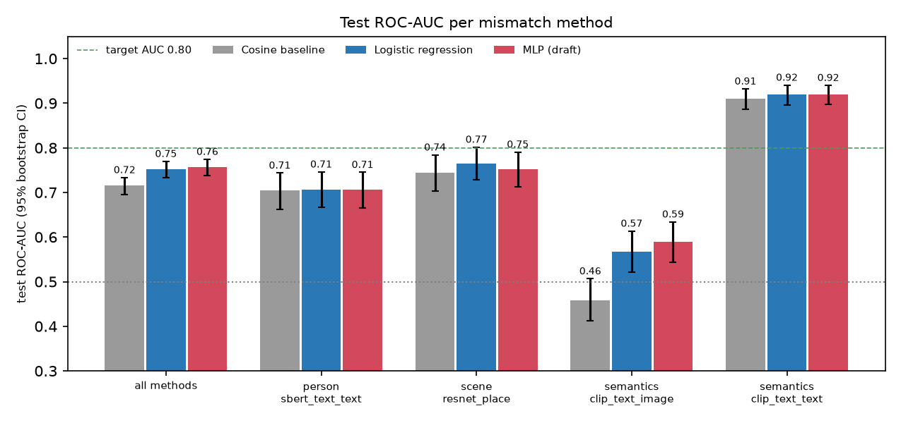
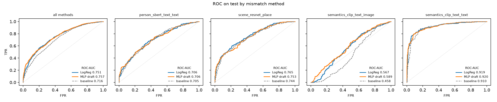
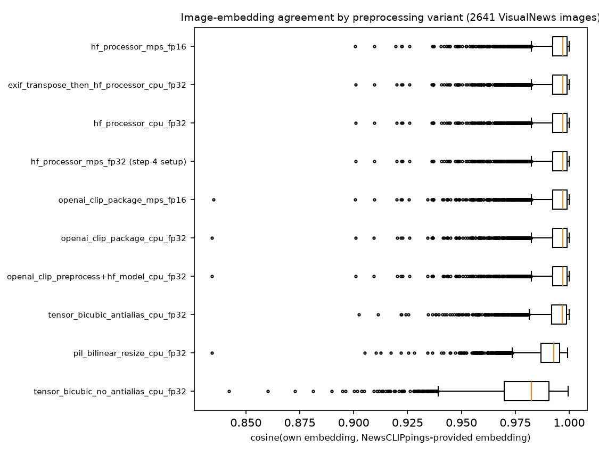

# Detecting Out-of-Context Image-Caption Misinformation with CLIP

DATA5500 Senior Design, Fall 2026. Author: **Mohamed Mohamed**. Instructor: **Weijie Pang**.

Out-of-context (OOC) misinformation pairs a **real, unedited photo** with a caption that misrepresents it. Pixel forensics finds nothing wrong with these images. This project instead measures whether the image and the caption *mean* the same thing. It uses frozen [CLIP](https://github.com/openai/CLIP) ViT-B/32 embeddings and classifiers trained on [NewsCLIPpings](https://github.com/g-luo/news_clippings), and it scores each pair as a likely genuine match or a likely out-of-context mismatch. The output is a **consistency score that supports a human decision; it is not a verdict**. Every result is reported per mismatch-generation method, because one aggregate number hides very different behaviour.

**Status (Week 7 of 14):** data preparation, the embedding-reproduction experiment, the similarity baseline, logistic regression, and a first-draft MLP are complete. Next: tune the neural network, then build the Streamlit app.

## Motivation
- Out-of-context reuse is one of the cheapest and most common forms of visual misinformation. Because the image is authentic, reverse image search and manipulation detectors often fail to flag it.
- CLIP puts images and text in one shared embedding space, so image-caption consistency becomes a measurable quantity.
- NewsCLIPpings builds its mismatches with several strategies (person, scene, and semantic similarity). Some of them are designed to fool exactly this kind of detector, so per-method evaluation is the honest way to report performance.

## Dataset
- **NewsCLIPpings** (Luo, Darrell, and Rohrbach, EMNLP 2021). Annotations for five subsets, metadata, and precomputed CLIP ViT-B/32 image and caption embeddings (about 2.6 GB). They are downloaded from the **Hugging Face *model* repo** `g-luo/news-clippings` (note: a model repo, not a dataset repo, so the URLs are `https://huggingface.co/g-luo/news-clippings/resolve/main/...`). Every subset is exactly 50/50 genuine vs. falsified.
- **Curated subset:** 24,000 pairs from `merged_balanced` (19,200 train / 2,400 val / 2,400 test). Every (mismatch method x label) cell has the same count. The four methods are `person_sbert_text_text`, `scene_resnet_place`, `semantics_clip_text_image`, and `semantics_clip_text_text`. Seed 5500. No caption ids overlap between splits.
- **VisualNews** (Liu et al., EMNLP 2021) supplies the source images. It is an open directory (`https://www.cs.rice.edu/~vo9/visualnews/`) with `origin.tar` at 91 GB. Only the first 1.5 GiB is streamed, via an HTTP range request, for the embedding-reproduction experiment. Modeling uses the provided embeddings.

Data is **not** committed. The scripts download it into `data/`.

## Method
Staged models, all on frozen CLIP ViT-B/32 embeddings (512-d, L2-normalised):

1. **Similarity baseline:** predict "falsified" when cosine(image, caption) is at or below a threshold chosen on validation (0.2811).
2. **Logistic regression:** features `[img, txt, img*txt, |img-txt|, cosine]` (2,049-d), then StandardScaler and L2 logistic regression. C is tuned on validation ROC-AUC (best C = 0.0003).
3. **MLP (first draft):** the same features, 2049 -> 512 -> 128 -> 1, ReLU, dropout 0.3 (input dropout 0.1), AdamW, early stopping on validation AUC.

Evaluation: test ROC-AUC, accuracy, and F1 (decision threshold chosen on validation), **overall and per mismatch method**. 95% percentile bootstrap CIs use 1,000 resamples with a fixed seed. A **paired bootstrap** of the AUC difference against the baseline is computed on identical resampled test rows.

## Results (test set, 2,400 pairs; 600 per method)

### ROC-AUC [95% bootstrap CI]
| Mismatch method | Cosine baseline | Logistic regression | MLP (draft) | LR minus baseline (paired) |
|---|---|---|---|---|
| **All methods** | 0.716 [0.696, 0.733] | 0.751 [0.733, 0.769] | **0.757** [0.738, 0.774] | **+0.036** [+0.023, +0.050] |
| Person, SBERT text-text | 0.705 [0.663, 0.743] | 0.706 [0.667, 0.746] | 0.706 [0.665, 0.745] | +0.001 [-0.025, +0.027] |
| Scene, ResNet place | 0.744 [0.704, 0.784] | 0.765 [0.728, 0.802] | 0.753 [0.713, 0.791] | +0.021 [-0.006, +0.046] |
| Semantic, CLIP text-image | 0.458 [0.413, 0.506] | 0.567 [0.521, 0.613] | 0.589 [0.543, 0.634] | +0.109 [+0.069, +0.148] |
| Semantic, CLIP text-text | 0.910 [0.886, 0.932] | 0.919 [0.896, 0.940] | 0.920 [0.898, 0.940] | +0.009 [-0.009, +0.028] |

MLP minus LR, overall: +0.005 [-0.004, +0.015]. This difference is not significant.

### Accuracy / F1 (threshold chosen on validation)
| Mismatch method | Baseline | Logistic regression | MLP (draft) |
|---|---|---|---|
| All methods | 0.637 / 0.580 | 0.682 / 0.685 | 0.676 / 0.689 |
| Person, SBERT text-text | 0.627 / 0.527 | 0.652 / 0.642 | 0.638 / 0.629 |
| Scene, ResNet place | 0.668 / 0.664 | 0.677 / 0.686 | 0.660 / 0.675 |
| Semantic, CLIP text-image | 0.422 / 0.227 | 0.557 / 0.555 | 0.575 / 0.619 |
| Semantic, CLIP text-text | 0.830 / 0.819 | 0.842 / 0.848 | 0.830 / 0.836 |

The CIs for accuracy and F1 are in `outputs/metrics/results.json`.

**Reading the numbers.** Learned features beat raw similarity overall, and the paired CI excludes zero. Almost all of the gain comes from the adversarial CLIP text-image subset. On the other three methods the CIs overlap the baseline. **No model reaches the 0.80 target yet.** Logistic regression reaches only about 0.80 AUC even on its *training* data. The MLP reaches 0.99 train AUC but peaks on validation at epoch 2. So a global CLIP embedding carries limited pair-level signal, and more capacity alone does not fix that.




### Known caveat: `semantics_clip_text_image` is adversarial by construction
This subset pairs captions with images that **CLIP itself** rated as similar. A CLIP-similarity threshold therefore scores *below chance* there (AUC 0.458): falsified pairs have a slightly *higher* mean cosine (0.300 vs. 0.295). Trained classifiers recover part of the gap (0.57 to 0.59), but this subset remains the hardest. It is reported as a per-method finding, not a bug.

### Embedding reproduction: can the app recompute the training embeddings?
I computed my own CLIP ViT-B/32 embeddings (`openai/clip-vit-base-patch32`, Hugging Face Transformers) for 2,641 VisualNews images and their captions. Agreement with the provided embeddings:

| Check | Result |
|---|---|
| Caption embeddings, cosine | mean 0.999999 |
| Image embeddings, cosine | mean 0.9936, median 0.9971, min 0.901 |
| Image-caption similarity, mine vs. provided | Pearson r = 0.993 |

**Where the small image gap comes from** (`src/06_embedding_preprocessing.py`). I tested 10 variants: the HF processor on MPS and CPU, fp32 and fp16, the official OpenAI `clip` package in fp32 and fp16, PIL bilinear resizing, tensor resizing with and without antialiasing, and EXIF transposition. **None of them closes the gap.** The HF, OpenAI-package, fp16, and CPU/MPS variants all land at mean 0.9935 to 0.9937, and they differ from *each other* by at most 0.0005. Bilinear resizing (0.990) and non-antialiased resizing (0.978) make agreement *worse*. The gap tracks image size instead: mean cosine is 0.986 for images with a short side under 300 px and 0.998 at 600 px and above (Spearman rho = 0.50 with pixel count). The worst cases are all small 464x261 or 512x288 JPEGs. The most likely explanation is that the provided embeddings were computed from **different image bytes** (a different resolution or JPEG encoding of the same photo), not a different pipeline. Precision, device, and the HF-vs-OpenAI choice do not matter. For the app, the default HF `CLIPProcessor` pipeline is as faithful as any alternative.



### Embedding-space projections
PCA and t-SNE of 2,000 test pairs show **no** genuine/falsified separation in 2-D (logistic regression on the 2-D coordinates gives AUC 0.46 to 0.51), but they show clear clustering by mismatch method.

## Repository structure
```
.
├── README.md
├── requirements.txt
├── src/
│   ├── 01_download_newsclippings.sh   download NewsCLIPpings annotations, metadata, CLIP embeddings
│   ├── 02_prep_data.py                validate data, build the curated 24k subset
│   ├── 03_baseline_similarity.py      cosine baseline, ROC/CI, per-method charts, PCA/t-SNE
│   ├── 04_own_embeddings.py           own CLIP embeddings from a partial VisualNews archive
│   ├── 05_logistic_regression.py      logistic regression + bootstrap CIs + paired delta vs. baseline
│   ├── 06_embedding_preprocessing.py  preprocessing/device/precision variants vs. provided embeddings
│   ├── 07_mlp.py                      first-draft MLP + bootstrap CIs
│   └── common.py                      shared loading, features, bootstrap evaluation, plots
├── outputs/
│   ├── figures/                       all charts
│   ├── metrics/                       results.json (every reported number), data_summary.json
│   └── models/                        logreg.joblib, mlp.pt (small trained classifiers)
├── docs/
│   ├── RUNLOG.md                      commands, run times, library versions
│   ├── BLOCKERS.md                    blockers and how they were solved
│   └── reports/                       proposal, project plan, design documents, progress reports (PDF)
└── data/                              (not committed) downloaded and curated data
```

## Setup
Python 3.11. Tested on Apple Silicon (PyTorch MPS); CPU works too.
```bash
python3.11 -m venv .venv && source .venv/bin/activate
pip install -r requirements.txt
# Optional, only for step 6 (official OpenAI preprocessing comparison):
pip install ftfy "git+https://github.com/openai/CLIP.git"
```

## Reproduce
```bash
./src/01_download_newsclippings.sh            # ~2.6 GB from HF model repo g-luo/news-clippings
python src/02_prep_data.py                     # curated subset -> data/curated/
python src/03_baseline_similarity.py           # baseline + figures
python src/05_logistic_regression.py           # logistic regression (~25 s)
python src/07_mlp.py                           # MLP draft (~40 s, CPU); needs step 5's model for the comparison

# Embedding experiments (need part of the VisualNews archive, ~1.5 GiB)
mkdir -p data/visualnews_partial
curl -r 0-1610612735 -o data/visualnews_partial/origin_head.tar https://www.cs.rice.edu/~vo9/visualnews/origin.tar
python -I src/04_own_embeddings.py data/visualnews_partial/origin_head.tar
python src/06_embedding_preprocessing.py       # ~3.5 min
```
All numbers are written to `outputs/metrics/results.json`. Run times and versions are in [docs/RUNLOG.md](docs/RUNLOG.md).

## Roadmap
| Weeks | Milestone | Status |
|---|---|---|
| 1 to 2 | Kickoff, dataset exploration, project plan | Done |
| 3 | Data preprocessing, design document | Done |
| 4 | Exploratory embedding analysis | Done |
| 5 | Similarity-threshold baseline | Done |
| 6 | Per-method visualizations | Done |
| 7 | Midterm progress report; logistic regression; embedding-gap diagnosis | Done |
| 8 to 9 | Neural network (draft done; tuning, per-method gap analysis) | In progress |
| 10 | Optional: COSMOS generalization check | |
| 11 | Streamlit app (image upload + caption, preset examples, score with explanation) | |
| 12 to 14 | Report, slides, poster, final presentation | |

## Documents
- [Project proposal](docs/reports/DATA5500_Proposal_Mohamed.pdf)
- [Project plan](docs/reports/DATA5500_ProjectPlan_Mohamed.pdf)
- Design document: [v1](docs/reports/DATA5500_DesignDocument_Mohamed_v1.pdf), [v2](docs/reports/DATA5500_DesignDocument_Mohamed_v2.pdf)
- Progress reports: [2](docs/reports/DATA5500_ProgressReport2_Mohamed.pdf), [3](docs/reports/DATA5500_ProgressReport3_Mohamed.pdf)
- [Run log](docs/RUNLOG.md), [blocker log](docs/BLOCKERS.md)

## References
1. Radford et al. (2021). Learning Transferable Visual Models From Natural Language Supervision. ICML. https://arxiv.org/abs/2103.00020
2. Luo, Darrell, and Rohrbach (2021). NewsCLIPpings: Automatic Generation of Out-of-Context Multimodal Media. EMNLP. https://arxiv.org/abs/2104.05893
3. Liu, Wang, Wang, and Ordonez (2021). Visual News: Benchmark and Challenges in News Image Captioning. EMNLP. https://arxiv.org/abs/2010.03743
4. Aneja, Bregler, and Niessner (2021). COSMOS: Catching Out-of-Context Misinformation with Self-Supervised Learning. https://arxiv.org/abs/2101.06278

## License
No license has been chosen yet, so the code is all rights reserved until a `LICENSE` file is added (MIT is the intended choice). Data is not redistributed here. NewsCLIPpings and VisualNews keep their own licenses and terms of use, and the images belong to their original news publishers. Download them from the original sources.
